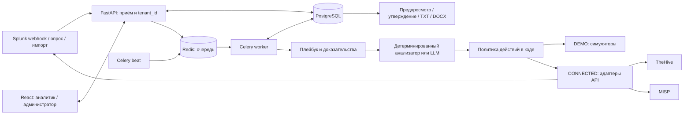

# Sauyt.Lab AI SOC L1 — прототип

Прототип обработки алертов для ЦОК ТОО «Sauyt.Lab». Интерфейс и отчёт передачи смены — на русском языке. DEMO работает без Splunk, TheHive, MISP и платной модели: через Docker Compose с PostgreSQL, Redis и Celery либо локально без Docker и WSL с SQLite и Celery eager. CONNECTED содержит HTTP-адаптеры, но требует отдельной проверки на ваших версиях и конфигурациях внешних систем.

Это инструмент поддержки аналитика, а не подтверждение полной замены SOC L1. До пилота на рабочей очереди нужны проверка источников, правил корреляции, прав API, безопасности данных и процедур ручной эскалации.

## Быстрый запуск DEMO

Нужны Docker Engine и Docker Compose. В PowerShell из корня проекта:

```powershell
Copy-Item .env.example .env
docker compose up --build -d
docker compose ps
```

Откройте [http://localhost:5173](http://localhost:5173). В DEMO исходные учётные записи: `admin` / `admin-demo`, `analyst` / `analyst-demo`. Пароли и ключи в `.env.example` служат **только для локальной демонстрации**; смените их до публикации сервиса в сети. Интерфейс показывает режим DEMO и отмечает симулированные внешние действия.

На странице «Демонстрационные сценарии» отправьте `root_approved`, `root_unapproved`, `root_parser_false_positive` и `unknown_rule`, затем проверьте очередь и карточки расследований. Первый сценарий классифицируется как `BENIGN_TRUE_POSITIVE`: вход действительно был в согласованном контексте. `root_unapproved` получает `TP` и создаёт симулированный кейс TheHive при разрешённом уровне действий. `root_parser_false_positive` получает `FP`: отдельный связанный результат Splunk с тем же ID подтверждает отказ вместо заявленного успеха; без утверждённой FP-политики и глобального флага он остаётся на проверке. `unknown_rule` получает `INCONCLUSIVE`. После работы Celery worker обновите страницу. [Каталог из 34 сценариев](docs/SCENARIOS.md) включает повторную доставку, связанные алерты, сбои интеграций, запоздалое событие и неопределённый результат действия. `expected_classification` и `expected_verdict` — критерии теста; они не передаются анализатору как доказательство.

Если интерфейс не отвечает, посмотрите состояние и журналы:

```powershell
docker compose ps
docker compose logs --tail=100 backend worker beat frontend
```

Остановить контейнеры без удаления БД: `docker compose down`. Данные PostgreSQL и Redis лежат в именованных томах Compose; обычный `down` их сохраняет.

### Локальный просмотр без Docker

Если Docker Engine или WSL недоступен, можно открыть ограниченный DEMO на одном компьютере. Сначала установите Python 3.12 и Node.js, затем в корне проекта:

```powershell
python -m venv backend/.venv
.\backend\.venv\Scripts\python.exe -m pip install -r backend/requirements.txt
Set-Location frontend
npm ci
Set-Location ..
```

Откройте два терминала в корне проекта:

```powershell
.\backend\.venv\Scripts\python.exe scripts\run_local_demo.py
```

```powershell
Set-Location frontend
$env:VITE_API_PROXY = 'http://127.0.0.1:8001'
npm run dev -- --host 127.0.0.1 --port 5173
```

Откройте `http://127.0.0.1:5173/`. Этот путь использует SQLite в `.qa/soc-v2.sqlite`, применяет Alembic до старта API и выполняет задачи Celery синхронно в процессе API. Он подтверждает работу интерфейса и сценариев, но не проверяет PostgreSQL, Redis, отдельный worker и надёжность очереди. Локальный `/api/health/ready` проверяет БД и возвращает `ready` без Redis, поскольку задачи исполняются в Celery eager. Скрипт слушает только loopback; для Compose и CONNECTED используйте отдельную конфигурацию. Прежняя `.qa/soc.sqlite` не изменяется этим скриптом.

## Архитектура и границы данных



1. Приём сохраняет исходный алерт и вложенные события отдельно. Уникальность `(tenant_id, source, source_event_id)` защищает от повторной доставки; разные алерты могут ссылаться на одно расследование.
2. Worker собирает локальный контекст, связанные события Splunk и совпадения MISP, выполняет версионированный плейбук, сохраняет доказательства и решение. Неизвестное правило попадает в общий плейбук.
3. Решение содержит один из пяти классов: `TP`, `FP`, `BENIGN_TRUE_POSITIVE`, `NOISE`, `INCONCLUSIVE`. Поле `verdict` служит совместимым маршрутом действий: `TP → true_positive`, `FP → false_positive`, остальные → `needs_review`. Класс и вердикт хранятся отдельно от `pipeline_state`. Только `FP` может пройти проверку FP-закрытия; согласованная реальная активность и шум не становятся ложным детектом.
4. Beat периодически проверяет интеграции, опрашивает Splunk в CONNECTED и возвращает незавершённые алерты в обработку. После исчерпания повторов задача попадает в очередь ошибок для ручного повтора.
5. Разрешённое создание кейса сначала фиксирует план внешних записей в `CaseWrite`: создание, страницу хронологии и доказательств, проверенные observables и задачи. Каждый шаг получает ключ идемпотентности и статус; результат `unknown` требует сверки внешней системы до повтора.
6. Отчёт смены формируется из БД без LLM. «Всего событий» означает число уникальных **исходных алертов** с `event_at` в интервале `[начало, конец)`; вложенные логи, соединения и инциденты считаются отдельно. Нормализованного счётчика соединений пока нет, поэтому он отмечается как неизвестный. Поздняя доставка учитывается при следующей версии отчёта.

Переходы `RECEIVED → VALIDATED → ENRICHING → TRIAGING → TRIAGED` и последующие ветви кейса, закрытия, проверки или ошибки валидируются сервером и сохраняются в `PipelineTransition`. Карточка расследования возвращает историю переходов через API. Администратор получает агрегаты `/api/metrics`: поступившие и дедуплицированные алерты, пять классов решений, кейсы, попытки и отказы автозакрытия, длительность обработки, ошибки интеграций, глубину очереди и открытые ошибочные задачи. Это снимок из БД конкретного заказчика, не Prometheus exporter.

Сущности модели: заказчик, пользователь, исходный алерт, вложенное событие, расследование, доказательство, выполнение плейбука, решение, действие, кейс, план записи кейса, версия FP-политики, событие политики, переход состояния, согласованная работа, актив, смена, отчёт, аудит, состояние интеграции, checkpoint, очередь ошибок и сообщение MISP. Запросы пользовательского API ограничиваются `tenant_id`; перед пилотом нужна отдельная проверка источников, которые выбирают заказчика при приёме.

## Интерфейс и роли

Сервер различает четыре роли. `viewer` читает данные своего заказчика; `analyst` дополнительно разбирает алерты и создаёт смены; `admin` управляет пользователями, уровнем действий, инвентарём и черновиками FP-политик, выполняет разрешённые ручные действия и утверждает отчёты; `policy_approver` отдельно утверждает FP-политику. Отозвать утверждение могут `policy_approver` и `admin`. Роль `admin` не может сама утвердить исключение. Ограничения проверяются в FastAPI. Токен входа хранится в `sessionStorage` браузера.

Интерфейс показывает пять классификаций, состояние конвейера, историю переходов и шаги записи кейса в расследовании. Доступны фильтр по классу, ручная классификация с обоснованием, страница метрик для администратора и действия с версиями FP-политики по роли. Выдача роли `policy_approver` пока выполняется через API `/api/users`.

Администратор создаёт учётные записи `viewer`, `analyst` и `policy_approver` через `/api/users`. Для FP-политики он создаёт черновик `/api/exceptions`, затем другой пользователь с ролью `policy_approver` вызывает `/api/exceptions/{id}/approve`. Доступны новая версия, отзыв и история `/api/exceptions/{id}/history`; утверждённая новая версия заменяет прежнюю. Контракт включает владельца, обоснование, правило из списка, точный `scope` с обязательными полями, `entity` из области и срок не более 90 дней. При действии сервер снова проверяет окно события и текущее время, совпадение полей, отдельного утверждающего, запись события политики и аудит. Подробности — в [руководстве CONNECTED](docs/CONNECTED.md#утверждение-fp-политики).

`controlled_automation` допускает разрешённое политикой создание кейса для `TP` и ручной запрос администратором. Уровень `auto_close` также допускает создание кейса и предназначен для автоматического FP-закрытия при `AUTO_CLOSE_ENABLED=true`; `approved_response` включает оба маршрута и ручные действия. В текущих правилах FP с допуском закрытия возможен только для узкого случая Root SSH: детектор заявил успешный вход, а связанное событие Splunk с тем же `detector_event_id` подтверждает отказ при отсутствии совпадающего успеха. Для ручного FP-закрытия нужны действующая утверждённая политика с совпадающей областью и уровень `controlled_automation` или `approved_response`; для автоматического дополнительно нужен `AUTO_CLOSE_ENABLED=true` и уровень из трёх разрешающих. Уровни `disabled`, `observe`, `recommend` не разрешают внешние записи. В DEMO первоначальный уровень основного заказчика — `controlled_automation`; в CONNECTED — `observe`.

Экспорт TXT/DOCX доступен после утверждения отчёта администратором. При изменении фактов, в том числе после позднего поступления алерта, можно утвердить следующую версию. Девять разделов отчёта и статусы MISP описаны в [коде формирования отчёта](backend/app/report.py).

## Проверки разработчика

Тесты backend запускаются из каталога `backend`. Локальный Python нужен версии 3.12. `requirements-dev.txt` устанавливает зависимости приложения и Ruff.

```powershell
Set-Location backend
python -m venv .venv
.\.venv\Scripts\python.exe -m pip install -r requirements-dev.txt
.\.venv\Scripts\python.exe -m pytest -q
.\.venv\Scripts\python.exe -m ruff check app tests alembic
Set-Location ..
```

Сборка интерфейса:

```powershell
Set-Location frontend
npm ci
npm run typecheck
npm run build
Set-Location ..
```

Опциональный [Makefile](Makefile) содержит `make up`, `down`, `logs`, `test`, `lint`, `migrate`; на Windows требуется установленный `make`, а `PYTHON` должен указывать на среду с зависимостями. Те же команды выше работают непосредственно в PowerShell.

В DEMO контейнер backend выполняет `alembic upgrade head` при запуске; локальный `scripts/run_local_demo.py` применяет Alembic к отдельной `.qa/soc-v2.sqlite`. В CONNECTED применяйте миграции отдельным контролируемым шагом **до** запуска приложения: `docker compose build backend`, затем `docker compose run --rm backend alembic upgrade head`; проверьте `docker compose exec backend alembic current`. Текущая цепочка миграций — `0001_initial` → `0002_case_writes` → `0003_policy_approval` → `0004_classification_state`. Health endpoints: `/api/health/live` и `/api/health/ready`; в Compose readiness проверяет БД и Redis, в локальном Celery eager — БД.

## Режим CONNECTED

Переменные перечислены в [.env.example](.env.example), порядок настройки и ограничения — в [docs/CONNECTED.md](docs/CONNECTED.md). Для CONNECTED используйте **отдельную БД**: приложение отклоняет запуск, если её исходный режим был DEMO. В CONNECTED начальный уровень заказчика — `observe`. Для реальных записей нужны одновременно `CONNECTED_WRITES_ENABLED=true`, точный список разрешённых действий в `CONNECTED_ALLOWED_ACTIONS` и изменение уровня администратором с записью в аудит. Базовый Splunk не имеет общего API «закрыть алерт», поэтому текущий `close_alert` в CONNECTED отклоняется и требует отдельного адаптера ES/SOAR. Демонстрационные блокировка учётной записи и изоляция хоста не воздействуют на реальные активы. Для нескольких заказчиков у CONNECTED пока нет раздельных credentials и поисковых шаблонов: запускайте отдельный экземпляр на заказчика.

Локальная Ollama необязательна: без `OLLAMA_BASE_URL` и `OLLAMA_MODEL` используется анализатор с детерминированными правилами, помеченный соответствующим именем. Для модели задайте адрес локального сервера и заранее скачанную модель; облачные модели и внешние AI-шлюзы не разрешены. Код ограничивает вход, выход, время и число запросов, маскирует чувствительные поля и проверяет структуру ответа и ссылки на доказательства. Настройка офлайн-модели и ограничения описаны в [docs/CONNECTED.md](docs/CONNECTED.md). До анализа реальных логов проверьте маскирование на фактических форматах событий.

## Данные для проверки

DEMO-сценарии синтетические. Дополнительно endpoint `POST /api/dataset/import` принимает Wazuh JSONL из [llm-soc-alert-triage](https://github.com/c0deing/llm-soc-alert-triage) через [маппер](backend/app/dataset.py). В проект включён [объединённый файл на 178 записей](backend/fixtures/README.md) для проверки без скачивания при запуске. Импорт доступен только в DEMO для роли `admin`; лимиты — 2 МБ и 200 записей за запрос. Для этого файла путь по умолчанию — `Data/2_Merged/2_alerts_preprocessed_merged_20250712_123030.jsonl`; если файл взят из другого пути `Data/`, передайте его как query-параметр `path`. Исходные метки TP/FP используются только для сравнительного счётчика в ответе импорта: они не попадают в алерт, не создают исключений и не разрешают автоматическое закрытие. Алерты Wazuh направляются в общий плейбук, который при детерминированном анализе выдаёт `needs_review`.

Пример загрузки в PowerShell 7 после сохранения локального фрагмента JSONL размером не более 2 МБ:

```powershell
$login = Invoke-RestMethod -Method Post -Uri 'http://localhost:5173/api/auth/login' -ContentType 'application/json' -Body '{"username":"admin","password":"admin-demo"}'
$fixture = Get-Item -LiteralPath 'C:\path\to\sample.jsonl'
Invoke-RestMethod -Method Post -Uri 'http://localhost:5173/api/dataset/import' -Headers @{ Authorization = "Bearer $($login.access_token)" } -Form @{ file = $fixture }
```

Для обычных нормализованных JSON/CSV алертов есть отдельный `POST /api/ingest/import`: роль `admin`, до 2 МБ и до 1000 алертов за запрос.

Согласованные работы и исключения используются как контекст плейбука при точном совпадении области и времени. Root SSH сверяет `host`, `src_ip`, `auth_method`; IPsec сверяет peer, устройство и туннель по локальному инвентарю. Подтверждённый штатный вход или туннель относятся к `BENIGN_TRUE_POSITIVE`, повторные неудачные согласования известного peer — к `NOISE`; ни один из этих классов не разрешает FP-закрытие. Для будущего FP-маршрута нужна отдельно утверждённая, действующая версия политики и FP-основание от детерминированного плейбука.

## Границы прототипа

- DEMO подтверждает работу локального процесса с симуляторами; это не проверка контрактов API Splunk, TheHive или MISP в конкретной инсталляции.
- Состояние `healthy` для API не доказывает полноту логов. Интерфейс отдельно показывает неизвестное состояние и время последнего поступления; отсутствие алертов не означает нормальную работу мониторинга.
- Правила пяти плейбуков предназначены для проверки процесса. Только узкий Root SSH путь выдаёт `FP` и допуск к закрытию после отдельной проверки связанного события; в DEMO само закрытие симулируется. Перед включением действий в CONNECTED нужны тесты на реальных нормализованных полях и согласование критериев с владельцами источников.
- `SUPPRESSED` присутствует в модели состояний и счётчике, но штатный процесс пока не переводит в него алерты. Снимок `/api/metrics` считает решения, в том числе повторные и ручные, а не число уникальных алертов по классификациям.
- План кейса добавляет доказательства «за/против», если решение содержит сохранённые ссылки. Автоматическое заполнение MITRE ATT&CK в текущем вызове построителя кейса не подключено.
- Отчёт не создаёт факты уведомления заказчика или передачи смены. Без соответствующих подтверждённых записей он прямо указывает, что факт неизвестен.

Для пилота на реальной очереди выполните [контрольный список](docs/CONNECTED.md#контрольный-список-пилота) и проведите пробный период в `observe` с ручным разбором решений.
