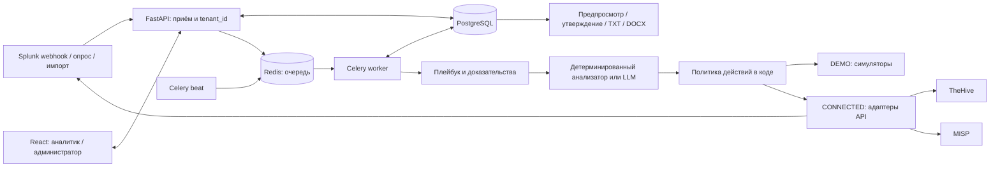

# Sauyt.Lab AI SOC L1 — прототип

Прототип обработки алертов для ЦОК ТОО «Sauyt.Lab». Интерфейс и отчёт передачи смены — на русском языке. DEMO работает локально без Splunk, TheHive, MISP и платной модели. Он проводит алерт через API, PostgreSQL, Redis/Celery, расследование, решение и разрешённое симулированное действие. CONNECTED содержит HTTP-адаптеры, но требует отдельной проверки на ваших версиях и конфигурациях внешних систем.

Это инструмент поддержки аналитика, а не подтверждение полной замены SOC L1. До пилота на рабочей очереди нужны проверка источников, правил корреляции, прав API, безопасности данных и процедур ручной эскалации.

## Быстрый запуск DEMO

Нужны Docker Engine и Docker Compose. В PowerShell из корня проекта:

```powershell
Copy-Item .env.example .env
docker compose up --build -d
docker compose ps
```

Откройте [http://localhost:5173](http://localhost:5173). В DEMO исходные учётные записи: `admin` / `admin-demo`, `analyst` / `analyst-demo`. Пароли и ключи в `.env.example` служат **только для локальной демонстрации**; смените их до публикации сервиса в сети. Интерфейс показывает режим DEMO и отмечает симулированные внешние действия.

На странице «Демонстрационные сценарии» отправьте `root_approved`, `root_unapproved` и `unknown_rule`, затем проверьте очередь и карточки расследований. По умолчанию `AUTO_CLOSE_ENABLED=false`: даже подходящий под правило `root_approved` остаётся на проверке без действия закрытия. `root_unapproved` создаёт симулированный кейс TheHive, `unknown_rule` получает `needs_review`. Чтобы отдельно проверить разрешённое автозакрытие в DEMO, явно задайте `AUTO_CLOSE_ENABLED=true`, перезапустите сервисы и повторите `root_approved`. Результат появляется после работы Celery worker, поэтому обновите страницу после обработки. [Каталог из 33 сценариев](docs/SCENARIOS.md) включает повторную доставку, связанные алерты, сбои интеграций, запоздалое событие и неопределённый результат действия. Поле `expected_verdict` в каталоге — ожидаемый результат теста, оно не передаётся анализатору как доказательство.

Если интерфейс не отвечает, посмотрите состояние и журналы:

```powershell
docker compose ps
docker compose logs --tail=100 backend worker beat frontend
```

Остановить контейнеры без удаления БД: `docker compose down`. Данные PostgreSQL и Redis лежат в именованных томах Compose; обычный `down` их сохраняет.

### Локальный просмотр без Docker

Если Docker Engine недоступен, можно открыть ограниченный DEMO на одном компьютере. Сначала установите Python-зависимости из `backend/requirements.txt` в `backend/.venv` и выполните `npm ci` в `frontend`. Затем откройте два терминала в корне проекта:

```powershell
.\backend\.venv\Scripts\python.exe scripts\run_local_demo.py
```

```powershell
Set-Location frontend
$env:VITE_API_PROXY = 'http://127.0.0.1:8001'
npm run dev -- --host 127.0.0.1 --port 5173
```

Откройте `http://127.0.0.1:5173/`. Этот путь использует SQLite в `.qa/soc.sqlite` и синхронное выполнение задач Celery в процессе API. Он подтверждает работу интерфейса и сценариев, но не проверяет PostgreSQL, Redis, отдельный worker и надёжность очереди. `/api/health/ready` поэтому останется недоступным без Redis. Скрипт слушает только loopback; для Compose и CONNECTED используйте отдельную конфигурацию.

## Архитектура и границы данных



1. Приём сохраняет исходный алерт и вложенные события отдельно. Уникальность `(tenant_id, source, source_event_id)` защищает от повторной доставки; разные алерты могут ссылаться на одно расследование.
2. Worker собирает локальный контекст, связанные события Splunk и совпадения MISP, выполняет версионированный плейбук, сохраняет доказательства и решение. Неизвестное правило попадает в общий плейбук.
3. Вердикт (`true_positive`, `false_positive`, `needs_review`) хранится отдельно от статуса обработки. Код проверяет уровень автономности перед действием. Создание кейса и закрытие учитываются через записи действия с ключом идемпотентности.
4. Beat периодически проверяет интеграции, опрашивает Splunk в CONNECTED и возвращает незавершённые алерты в обработку. После исчерпания повторов задача попадает в очередь ошибок для ручного повтора.
5. Отчёт смены формируется из БД без LLM. «Всего событий» означает число уникальных **исходных алертов** с `event_at` в интервале `[начало, конец)`; вложенные логи, соединения и инциденты считаются отдельно. Нормализованного счётчика соединений пока нет, поэтому он отмечается как неизвестный. Поздняя доставка учитывается при следующей версии отчёта.

Сущности модели: заказчик, пользователь, исходный алерт, вложенное событие, расследование, доказательство, выполнение плейбука, решение, действие, кейс, исключение, согласованная работа, актив, смена, отчёт, аудит, состояние интеграции, checkpoint, очередь ошибок и сообщение MISP. Запросы пользовательского API ограничиваются `tenant_id`; перед пилотом нужна отдельная проверка источников, которые выбирают заказчика при приёме.

## Интерфейс и роли

Аналитик видит очередь, фильтры алертов, расследование с доказательствами и шагами плейбука, инвентарь активов и пользователей, сообщения MISP, может исправить вердикт и создать смену. Администратор дополнительно управляет политикой действий, инвентарём, исключениями и согласованными работами, фиксирует передачу сообщения MISP в L2 с номером подтверждения, проверяет интеграции, запускает повтор ошибочной задачи, сверяет действие `unknown`, изменяет статус подтверждённого кейса при уровне `approved_response` и утверждает отчёт. Ограничения ролей проверяются в FastAPI, а не только в React. Токен входа хранится в `sessionStorage` браузера.

Экспорт TXT/DOCX доступен после утверждения отчёта администратором. При изменении фактов, в том числе после позднего поступления алерта, можно утвердить следующую версию. Девять разделов отчёта и статусы MISP описаны в [коде формирования отчёта](backend/app/report.py).

## Проверки разработчика

Тесты backend запускаются из каталога `backend`. Локальный Python нужен версии 3.12, если не используется совместимая уже установленная среда.

```powershell
Set-Location backend
python -m venv .venv
.\.venv\Scripts\python.exe -m pip install -r requirements.txt
.\.venv\Scripts\python.exe -m pytest -q
Set-Location ..
```

Сборка интерфейса:

```powershell
Set-Location frontend
npm ci
npm run build
Set-Location ..
```

В DEMO миграция Alembic выполняется при запуске backend. В CONNECTED применяйте миграции отдельным контролируемым шагом **до** запуска приложения, включая `0002_case_writes` для существующей БД: `docker compose build backend`, затем `docker compose run --rm backend alembic upgrade head`. После запуска проверьте `docker compose exec backend alembic current`. Health endpoints внутри сети Compose: `/api/health/live` и `/api/health/ready`; readiness проверяет PostgreSQL и Redis. Метрики текущей очереди доступны администратору через `/api/metrics`, но пока это ответ API, а не экспортёр Prometheus.

## Режим CONNECTED

Переменные перечислены в [.env.example](.env.example), порядок настройки и ограничения — в [docs/CONNECTED.md](docs/CONNECTED.md). Для CONNECTED используйте **отдельную БД**: приложение отклоняет запуск, если её исходный режим был DEMO. В CONNECTED начальный уровень заказчика — `observe`: чтение, доказательства и рекомендации. Для реальных записей нужны одновременно настройка `CONNECTED_WRITES_ENABLED=true`, перечисление разрешённых действий в `CONNECTED_ALLOWED_ACTIONS` и изменение уровня через учётную запись `admin` с записью в аудит. Базовый Splunk не имеет общего API «закрыть алерт», поэтому `close_alert` требует отдельного адаптера под установленный ES/SOAR или другую систему кейсов. Демонстрационные блокировка учётной записи и изоляция хоста не воздействуют на реальные активы.

Локальная Ollama необязательна: без `OLLAMA_BASE_URL` и `OLLAMA_MODEL` используется анализатор с детерминированными правилами, помеченный соответствующим именем. Для модели задайте адрес локального сервера и заранее скачанную модель; облачные модели и внешние AI-шлюзы не разрешены. Код ограничивает вход, выход, время и число запросов, маскирует чувствительные поля и проверяет структуру ответа и ссылки на доказательства. Настройка офлайн-модели и ограничения описаны в [docs/CONNECTED.md](docs/CONNECTED.md). До анализа реальных логов проверьте маскирование на фактических форматах событий.

## Данные для проверки

DEMO-сценарии синтетические. Дополнительно endpoint `POST /api/dataset/import` принимает Wazuh JSONL из [llm-soc-alert-triage](https://github.com/c0deing/llm-soc-alert-triage) через [маппер](backend/app/dataset.py). В проект включён [объединённый файл на 178 записей](backend/fixtures/README.md) для проверки без скачивания при запуске. Импорт доступен только в DEMO для роли `admin`; лимиты — 2 МБ и 200 записей за запрос. Для этого файла путь по умолчанию — `Data/2_Merged/2_alerts_preprocessed_merged_20250712_123030.jsonl`; если файл взят из другого пути `Data/`, передайте его как query-параметр `path`. Исходные метки TP/FP используются только для сравнительного счётчика в ответе импорта: они не попадают в алерт, не создают исключений и не разрешают автоматическое закрытие. Алерты Wazuh направляются в общий плейбук, который при детерминированном анализе выдаёт `needs_review`.

Пример загрузки в PowerShell 7 после сохранения локального фрагмента JSONL размером не более 2 МБ:

```powershell
$login = Invoke-RestMethod -Method Post -Uri 'http://localhost:5173/api/auth/login' -ContentType 'application/json' -Body '{"username":"admin","password":"admin-demo"}'
$fixture = Get-Item -LiteralPath 'C:\path\to\sample.jsonl'
Invoke-RestMethod -Method Post -Uri 'http://localhost:5173/api/dataset/import' -Headers @{ Authorization = "Bearer $($login.access_token)" } -Form @{ file = $fixture }
```

Для обычных нормализованных JSON/CSV алертов есть отдельный `POST /api/ingest/import`: роль `admin`, до 2 МБ и до 1000 алертов за запрос.

Там, где плейбук опирается на исключение или согласованную работу, автоматическое закрытие требует действующей записи с **непустым `scope`**, поля которого совпадают с полями исходного события. Для Root SSH область должна покрывать `host`, `src_ip` и `auth_method`; для проверки настройки IPsec дополнительно сверяются peer, устройство и туннель по локальному инвентарю. Отдельный сценарий разрешённого site-to-site VPN опирается на инвентаризацию известного peer. Пустая или просроченная область не даёт основания для закрытия по согласованию. Эти условия необходимо сопоставить с реальными источниками перед пилотом.

## Границы прототипа

- DEMO подтверждает работу локального процесса с симуляторами; это не проверка контрактов API Splunk, TheHive или MISP в конкретной инсталляции.
- Состояние `healthy` для API не доказывает полноту логов. Интерфейс отдельно показывает неизвестное состояние и время последнего поступления; отсутствие алертов не означает нормальную работу мониторинга.
- Правила пяти плейбуков предназначены для проверки процесса. Перед включением действий в CONNECTED им нужны тесты на реальных нормализованных полях и согласование критериев с владельцами источников.
- Отчёт не создаёт факты уведомления заказчика или передачи смены. Без соответствующих подтверждённых записей он прямо указывает, что факт неизвестен.

Для пилота на реальной очереди выполните [контрольный список](docs/CONNECTED.md#контрольный-список-пилота) и проведите пробный период в `observe` с ручным разбором решений.
